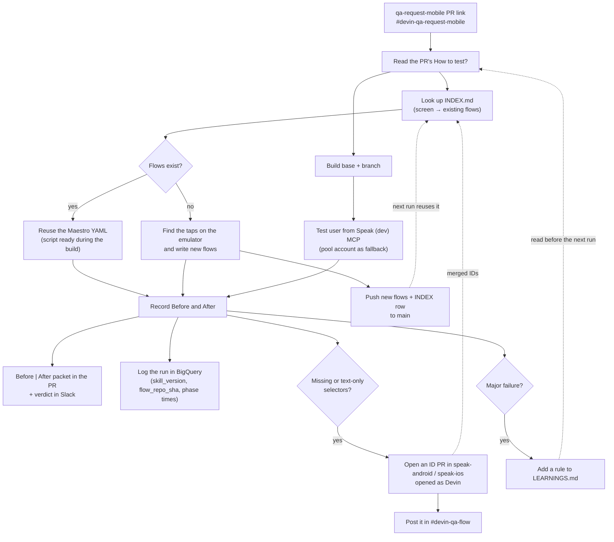

# devin-qa-flow

Reusable [Maestro](https://maestro.dev) UI flows for Devin's `qa-request-mobile` runs on
[speak-android](https://github.com/usespeakeasy/speak-android) and
[speak-ios](https://github.com/usespeakeasy/speak-ios).

Devin writes and maintains everything here. Developers don't need to write flows: a QA run
reuses the flows that already cover the screens a PR touches, adds the missing ones, and
pushes them back so the next run on that screen starts from a working script instead of
rewriting taps from scratch.

## Request QA

1. Post `qa-request-mobile <PR link>` in #devin-qa-request-mobile (a PR comment or Linear issue works too).
2. Devin replies with an ETA.
3. Read the verdict in Slack and the Before | After table in the PR description.

| Channel | What happens there |
| --- | --- |
| #devin-qa-request-mobile | Anyone (or a bot) asks for QA. Devin replies with an ETA, runs it and posts the verdict. |
| #devin-qa-flow | Devin posts each ID PR as one top-level post, with details and the QA thread link in a reply. |

## How a run works



The dotted lines are the learning loop: whatever one run adds (flows, IDs, rules) is ready for
the next run.

## Layout

```
INDEX.md                         screen -> flow lookup (start here)
android/common/                  shared subflows (launch to Home, deep link, prompts)
android/flows/<area>/<case>.yaml one QA case per file
ios/common/, ios/flows/          same structure for the iOS Simulator
skills/                          source of the qa-request-mobile skill and Android harness
CHANGELOG.md                     what changed in the skills and instructions, by version
```

## Running a flow

```bash
curl -fsSL "https://get.maestro.mobile.dev" | bash      # once; needs Java 17+
maestro --device emulator-5554 test android/flows/main-tabs/tab-tour.yaml
maestro --device emulator-5554 test -e APP_ID=com.selabs.speak.dev android/flows/<area>/<case>.yaml
```

Most flows start signed in: the run signs in a test user from the Speak (dev) MCP, or leases
a pool account when the session lacks the `test_*` tools.
Pre-auth flows (`android/flows/auth/`, `android/flows/onboarding/`) start signed out instead;
their header says `Entry: app data cleared` and the harness `fresh` command gets the app there.
Account lease, login, screen recording and the Before | After packet come from the
`qa-request-mobile` skill and its Android harness, not from this repo.

Flows are plain steps on resource IDs (`tapOn: {id: ...}`, `assertVisible`, `openLink`), so each
step maps directly to Espresso / UiAutomator, XCUITest or Appium if we move away from Maestro or Devin.

QA runs follow [docs/qa-pr-instructions.md](docs/qa-pr-instructions.md) (workflow for Android and
iOS, two emulators, committing, conflicts, missing and stale IDs, learnings, PR and Slack writing)
and read [LEARNINGS.md](LEARNINGS.md), where runs record what went wrong. Flow-file and INDEX.md rules
are in [AGENTS.md](AGENTS.md). `.agents/skills/` vendors the
[i-have-adhd](https://github.com/ayghri/i-have-adhd) and [humanizer](https://github.com/blader/humanizer)
writing skills (MIT).

The `qa-request-mobile` skill and its Android harness are kept in [skills/](skills/) and
versioned; [CHANGELOG.md](CHANGELOG.md) lists each change. Each QA run records the skill version
and this repo's SHA in BigQuery (`devin_qa.qa_request_mobile_runs`).
